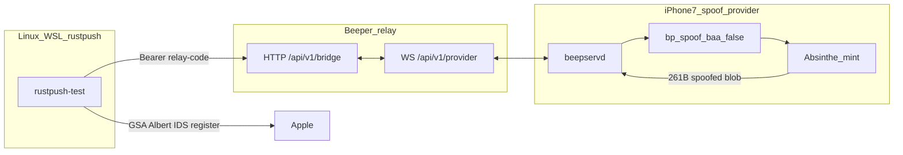

# Architecture — spoofing validation-data provider

This repo is the **iPhone spoofing provider** for Beeper / rustpush. The only supported
production mode is: **spoofed serial/UDID/IMEI + Absinthe `baa:false`**, rotated per
registration via [`ops/relayrotate`](ops/relayrotate).

Real-hardware passthrough (`Enabled=false`) is debug-only and is **not** a Beeper farm path.

The registration client is a separate repo
([rustpush](https://github.com/hilmiazizi/rustpush)). Phone and rustpush do **not** talk
directly — both use Beeper’s registration-relay.

## Two repos

| Repo | Role | Runs on | Owns |
|------|------|---------|------|
| **phone-registration-provider** (this) | Spoofing provider | Jailbroken iPhone 7 | Rotating spoof identity, `baa:false` mint, version-info |
| **rustpush** | Consumer | Linux/WSL (Albert = MacOS) | Apple ID login, anisette, APS, `id-register`, BBOX |

**Shared contract only:**

| Call | Result (farm) |
|------|----------------|
| Pairing | Relay code in `.beepserv_state` |
| `get-version-info` | **Spoofed** serial / UDID (must match `.beepserv_spoof.plist`) |
| `get-validation-data` | ~261B Absinthe blob bound to that spoof (`baa:false`) |

## Why spoof is mandatory

Beeper farm goal = many off-device iMessage registrations per physical phone. That requires:

1. **New device identity per account** — `relayrotate` regenerates serial/UDID/IMEI  
2. **`baa:false`** — otherwise SEP BAA ties the blob to the real fused serial  
3. Matching **version-info** and **blob** — both read the same spoof plist  

Without spoof, every account shares `F4JSDXCEHG7K` (this fleet’s real serial) and the farm
collapses to one hardware identity.

## Phone product surface

`com.beeper.beepserv` (pin: see [INSTALL.md](INSTALL.md)):

| Component | Job |
|-----------|-----|
| `beepservd` | Relay WS; write/rotate `.beepserv_spoof.plist`; report spoofed version-info |
| `BeepservIdentityServices` | `bp_spoof.x` (gestalt + `baa:false`) + IDS queue mint → `setValidationData:` |
| App / NotificationHelper | Code display / bulletins |

Ops: **`/var/root/relayrotate`** — every farm cycle starts here.

## Mint path (spoofed)

1. `relayrotate` → `Enabled=true`, `.beepserv_kill`, new identity, new relay code  
2. rustpush asks relay for validation-data  
3. idsd queues stub registration → Absinthe with spoofed Absinthe serial fields  
4. Capture ~261B → swallow send → return via relay  

## Runtime files (farm)

| Path | Required state |
|------|----------------|
| `.beepserv_spoof.plist` | `Enabled=true` + current spoof tuple |
| `.beepserv_kill` | Present (force `baa:false`) |
| `.beepserv_state` | Current relay code |
| `.beepserv_rotate` | Consumed by daemon during rotate |

## Two rotatable identities

1. **Phone spoof** (serial/UDID/IMEI in blob) — `relayrotate`  
2. **Anisette** (`X-Apple-I-MD-M`) — rustpush per-account plist  

## Docs

| Doc | Use |
|-----|-----|
| [INSTALL.md](INSTALL.md) | Fresh phone → first `relayrotate` (spoof on) |
| [FARM.md](FARM.md) | Every account: rotate → register |
| [research/README.md](research/README.md) | Archive — do not install on farm phones |

